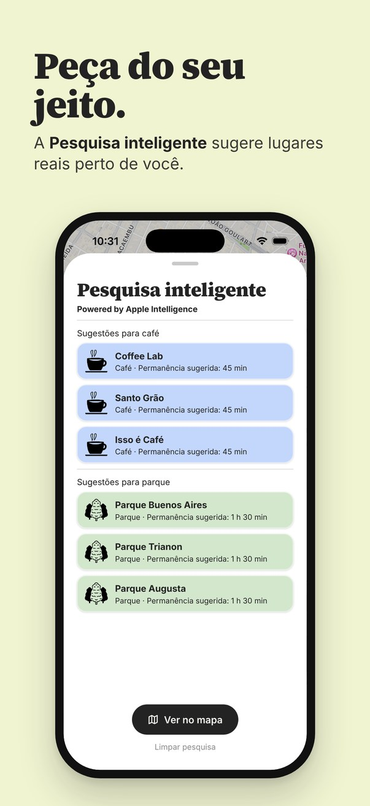
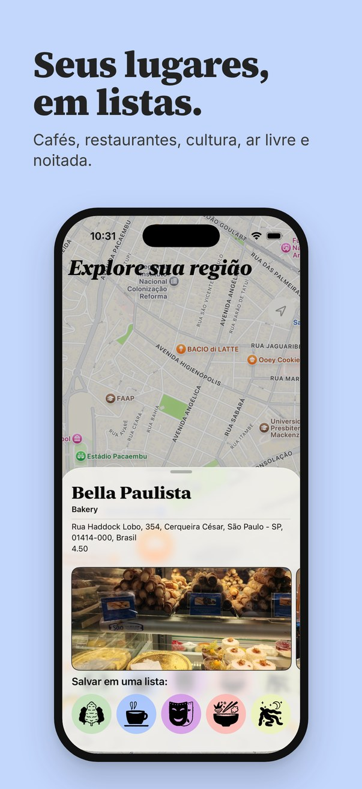
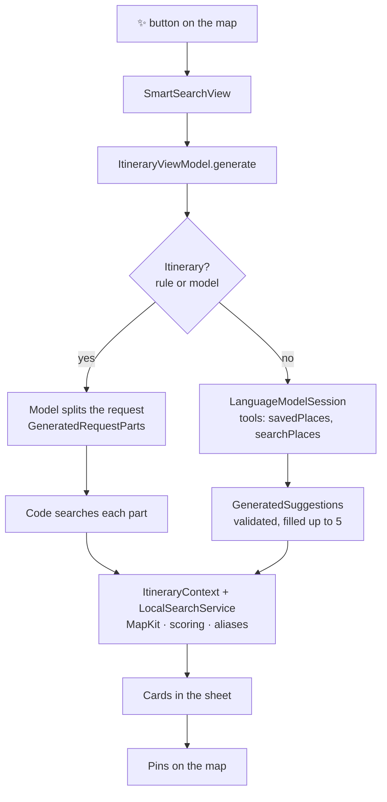

<div align="center">


# Pontilho

### Save the places you want to go. Discover new ones with on-device AI. 📍

Pontilho is a native iOS app for saving places on a map in themed lists, so the café a friend
recommended or the museum you saw online never gets lost in screenshots again. Its **Smart
Search** uses Apple Intelligence, running entirely on the iPhone, to turn a request like
*"a coffee and then a park"* into real places nearby.

<br/>

[](https://apps.apple.com/br/app/pontilho/id6749077911)
[](https://www.apple.com/ios/)
[](https://swift.org)
[](https://developer.apple.com/xcode/swiftui/)
[](https://developer.apple.com/documentation/mapkit)
[](https://developer.apple.com/documentation/foundationmodels)

</div>

---

## 📑 Table of Contents

- [About](#-about)
- [Screenshots](#-screenshots)
- [Features](#-features)
- [How Smart Search Works](#-how-smart-search-works)
- [Tech Stack](#️-tech-stack)
- [Architecture](#️-architecture)
- [Project Structure](#-project-structure)
- [Getting Started](#-getting-started)
- [Author](#-author)

---

## 📖 About

We find interesting places all the time: a café a friend recommended, a museum from a post, a
restaurant someone mentioned. Most of them end up lost in screenshots and notes. **Pontilho**
(from *pontilhar*, "to dot") gives each of them a dot on the map.

You save places into five themed lists (**Cafés, Restaurants, Culture, Outdoors and Nightlife**),
tap a list to see its places on the map, and open any of them for photos, rating and opening
hours, or for directions in Apple Maps.

When you don't know where to go, **Smart Search** helps. Describe what you feel like doing and
Pontilho suggests real places nearby, ranked by the kinds of places you save the most. The
language model runs **on the device**, so your request, location and lists never leave your iPhone.

Pontilho is **live on the App Store**: [download it here](https://apps.apple.com/br/app/pontilho/id6749077911).

---

## 📸 Screenshots

<div align="center">





</div>

---

## 🚀 Features

- **🗂️ Themed lists**: save places to Cafés, Restaurants, Culture, Outdoors or Nightlife; tap a list to show its places on the map.
- **🔎 Place search**: search by text around you or in any area of the map, with a "search this area" shortcut when you move it.
- **🖼️ Place details**: photos, rating and opening hours fetched live from Google Places, with the required attribution.
- **🧭 Directions**: open any saved place in Apple Maps.
- **🔔 Reminders**: local notifications nudge you to visit the places you saved.
- **✨ Smart Search (Apple Intelligence)**: one text field, three modes picked from your request:
  - **Search**: *"japanese food in Pinheiros"* → 5 new places.
  - **Itinerary**: *"a museum, lunch and a bar"* → 3 suggestions for each part of the request.
  - **Feeling lucky**: leave it empty and Pontilho draws a kind of place from your taste.
- **📍 Straight to the map**: tap a suggestion, or *See on map*, and the results become pins; one tap clears them.
- **♿ Accessible**: full VoiceOver support (labels, headings for the rotor, spoken progress and results) and Reduce Motion.
- **💧 Liquid Glass**: native iOS 26 design, with a matching fallback on iOS 18.

---

## ✨ How Smart Search Works

A small language model running on a phone is great with language and weak with facts: it can
invent names, mistype long identifiers or stop halfway through a multi-step task. So Pontilho
splits the work:

| The model does | The code does |
|----------------|---------------|
| Classify ambiguous requests (one place or an itinerary) | Detect obvious itineraries with rules (commas, "then", "itinerary"…) |
| Split an itinerary into parts ("museum", "lunch", "bar") | Search real places in MapKit for each part |
| Drive the tools in suggestion mode | Score results, weighted random draws, validate everything the model returns |
| | Compute the suggested time to spend at each place |



Techniques used:

- **Tool calling**: the model calls Swift `Tool`s to read the user's taste profile (`savedPlaces`) and search real places in MapKit (`searchPlaces`). The agent → tool → agent loop runs inside the session's `respond`.
- **Structured generation**: answers come back as `@Generable` Swift types constrained with `@Guide` (`.anyOf`, `.maximumCount`, `.range`), so there is no free-text parsing.
- **Hallucination guards**:
  - Places get short aliases (`L1`, `L2`…) instead of long IDs, and only aliases a tool actually returned are accepted.
  - An area name counts only if it appears in the user's request.
  - Free-text fields generated by the model were removed: every field the model doesn't write is one it can't make up.
- **Robustness**: one retry on failure; handling of `exceededContextWindowSize`, `guardrailViolation` and `unsupportedLanguageOrLocale`; a category search as plan B; and code fills the list when the model returns too few results.
- **Availability**: the app checks `SystemLanguageModel.default.availability`. On devices without Apple Intelligence the ✨ button is hidden; when it's off or still downloading, the sheet explains why. Everything else works on iOS 18.

---

## 🛠️ Tech Stack

| Area | Tech |
|------|------|
| UI | SwiftUI · Liquid Glass · custom `TextRenderer` animations |
| On-device AI | Foundation Models (Apple Intelligence): `LanguageModelSession`, `Tool`, `@Generable`, `@Guide` |
| Maps & places | MapKit (`MKLocalSearch`, points of interest, `mapScope`) · Google Places SDK (`GooglePlacesSwift`) |
| Persistence | Core Data (saved places stay on the device) |
| Concurrency | async/await · `@MainActor` view models · cancellable `Task` and `.task(id:)` |
| System integrations | CoreLocation · UserNotifications · Apple Maps |
| Accessibility | VoiceOver · accessibility announcements · Reduce Motion |
| Architecture | MVVM with `@Observable` · protocol-based repository |

---

## 🏛️ Architecture

- **Views** only draw the screen and forward actions; they don't know where data comes from.
- **ViewModels** (`@Observable`, `@MainActor`) hold screen state and coordinate services.
- **Services and repositories** talk to the outside world: MapKit, Google Places, Core Data and the language model. `SearchRepository` implements `SearchRepositoryProtocol`, so view models depend on a protocol rather than on the Google SDK.

Smart Search was built almost entirely in new files and plugs into the existing app at a few
points: it reuses the search pins (`MapViewModel.searchResults`), the place details sheet and the
lists defined in `LocalEnum`.

**Concurrency**: searches, network calls and model generation use async/await. Smart Search runs
in a `Task` owned by its view model, so closing the sheet or clearing the search cancels it, and
the place sheets use `.task(id:)`, so switching places cancels the previous photo request.
MapKit results are cached for 5 minutes to avoid repeated requests.

---

## 📂 Project Structure

```
Pontilho/
├── Models/            # Core Data model, LocalEnum (lists ↔ MapKit categories), @Generable types
├── ViewModel/         # MapViewModel, SearchViewModel, CDViewModel, ItineraryViewModel
├── Services/          # LocalSearchService (MapKit), PlacesAPI (Google), ImageStorage
│   └── Itinerary/     # ItineraryContext (search, scoring, draws) and ItineraryTools (model tools)
├── Repositories/      # SearchRepository + protocol (Google Places access)
├── Views/             # Map, place sheets, lists and components
│   └── Itinerary/     # Smart Search sheet and map controls
└── Extentions/        # Helpers (MKMapItem, detents, strings)
Screenshots/           # Images used in this README
```

---

## 🎯 Getting Started

### Requirements

- Xcode 26+
- iOS 18.5+
- iOS 26 and an Apple Intelligence–capable device for Smart Search
- A Google Places API key

### Run

```bash
git clone https://github.com/hissapinto/Pontilho.git
cd Pontilho
```

Create `Pontilho/Secrets.xcconfig` (it's in `.gitignore`) with your key:

```
GOOGLE_PLACES_API_KEY = your_key_here
```

Then open `Pontilho.xcodeproj`, set your own **Signing Team**, and run. To try Smart Search in the
simulator, use a Mac with Apple Intelligence turned on and set a location in
**Features › Location**.

---

## 👩‍💻 Author

Built at the **Apple Developer Academy | Mackenzie**.

<table>
  <tr>
    <td align="center">
      <a href="https://github.com/hissapinto"></a>
      <br/><sub><b>Isabela Hissa</b></sub><br/>
      <a href="https://github.com/hissapinto"></a>
      <a href="https://www.linkedin.com/in/hissapinto/"></a>
    </td>
  </tr>
</table>
