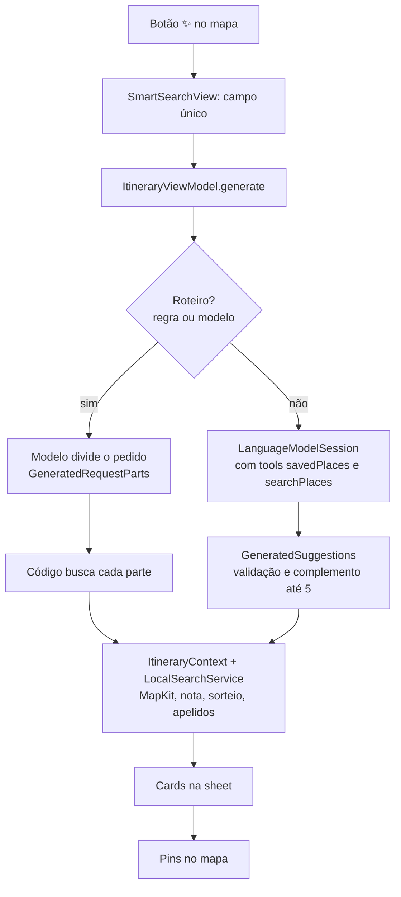

# Pontilho

**Um app iOS para salvar os lugares que você quer conhecer e descobrir novos com uma pesquisa inteligente que roda no próprio iPhone.**

## Sobre o projeto

O Pontilho nasceu de um problema simples: a gente descobre lugares legais o tempo todo (um café indicado por um amigo, um museu visto no Instagram), mas eles se perdem em prints e anotações. No Pontilho, você salva cada lugar no mapa, numa de cinco listas (Cafés, Restaurantes, Cultural, Ar livre e Noitada), e encontra tudo quando estiver por perto.

O app também tem a **Pesquisa inteligente**: você descreve o que quer fazer ("um café de manhã e depois um parque") e o app sugere lugares reais perto de você, usando o modelo de linguagem da **Apple Intelligence**, que roda **no próprio aparelho**, e o seu gosto (as listas em que você mais salva).

Desenvolvi o Pontilho do zero, passando por concepção, design, desenvolvimento, publicação na App Store e evolução contínua. O projeto aprofunda SwiftUI, arquitetura MVVM, integração com APIs e concorrência em Swift, e explora **engenharia de IA aplicada**: tool calling, geração estruturada e um design híbrido entre modelo e código.

## Funcionalidades

- Salvar lugares no mapa em cinco listas, cada uma com cor e desenho próprios.
- Buscar lugares por texto, na sua região ou na área visível do mapa.
- Ver fotos, nota e horários de funcionamento de cada lugar (Google Places).
- Abrir o lugar no app Mapas da Apple para ver a rota.
- Receber lembretes locais para visitar os lugares salvos.
- **Pesquisa inteligente**, com três modos que o app escolhe a partir do pedido:
  - **Buscar**: "comida japonesa em Pinheiros" → 5 sugestões novas.
  - **Montar roteiro**: "museu, almoço e um bar" → 3 sugestões para cada parte do pedido.
  - **Tentar a sorte**: campo vazio → o app sorteia um tipo de lugar pelo seu gosto e sugere opções.
- Os resultados aparecem em cards e viram pins no mapa com um toque.

## Pesquisa inteligente: a engenharia de IA

A feature usa o framework **Foundation Models** (iOS 26), que dá acesso ao modelo de linguagem da Apple Intelligence direto no aparelho. Sem servidor e sem custo por chamada, e o pedido da pessoa não sai do iPhone.

### Design híbrido: o modelo entende, o código decide

Um modelo pequeno, rodando no aparelho, é ótimo com linguagem e fraco com fatos: inventa nomes, erra identificadores longos, para no meio de tarefas com muitas etapas. Por isso a responsabilidade foi dividida:

| O modelo faz | O código faz |
| --- | --- |
| Classificar pedidos ambíguos (lugar ou roteiro) | Detectar roteiros óbvios por regra (vírgula, "depois", "roteiro"…) |
| Dividir um roteiro em partes ("museu", "almoço", "bar") | Buscar lugares reais no MapKit para cada parte |
| Conduzir as ferramentas no modo de sugestões | Pontuar resultados, sortear com pesos e validar tudo o que o modelo devolve |
| | Calcular a permanência sugerida por categoria |

### Pipeline



### Técnicas usadas

- **Tool calling**: o modelo chama ferramentas Swift (`Tool`) para ler o perfil de gosto da pessoa (`savedPlaces`) e buscar lugares reais no MapKit (`searchPlaces`). O loop agente → ferramenta → agente acontece dentro do `respond` da sessão.
- **Geração estruturada (guided generation)**: as respostas vêm como tipos Swift marcados com `@Generable`, com restrições em `@Guide` (`.anyOf`, `.maximumCount`, `.range`). Assim não há parsing de texto livre.
- **Contra alucinação**:
  - Os lugares recebem apelidos curtos (`L1`, `L2`…) em vez de IDs longos, e só é aceito o apelido que a ferramenta realmente mostrou.
  - O campo de área só vale se aparecer no pedido da pessoa.
  - Os campos de texto livre gerados pelo modelo foram removidos: cada campo a menos é uma chance a menos de inventar.
- **Robustez**:
  - Uma nova tentativa quando a geração falha.
  - Tratamento de `exceededContextWindowSize`, `guardrailViolation` e `unsupportedLanguageOrLocale`.
  - Uma busca por categoria como plano B.
  - O código completa as sugestões quando o modelo devolve menos que o esperado.
- **Personalização sem dados na nuvem**: as listas mais usadas aumentam a nota dos lugares parecidos, e o modo "sorte" faz um sorteio ponderado entre os melhores resultados, com variedade sem perder qualidade.
- **Disponibilidade**: o app checa `SystemLanguageModel.default.availability`. Em aparelhos sem Apple Intelligence o botão nem aparece. Com ela desligada ou baixando, a sheet explica o motivo. O app continua funcionando no iOS 18 sem a feature.

## Arquitetura

O projeto segue **MVVM** com SwiftUI e `@Observable`:

```
Pontilho/
├── Models/          Core Data, LocalEnum (listas ↔ categorias do MapKit), tipos @Generable
├── ViewModel/       MapViewModel, SearchViewModel, CDViewModel, ItineraryViewModel
├── Services/        LocalSearchService (MapKit), PlacesAPI (Google), ImageStorage
│   └── Itinerary/   ItineraryContext (busca, nota, sorteio) e ItineraryTools (tools do modelo)
├── Repositories/    SearchRepository (camada de acesso ao Google Places)
├── Views/           Telas e componentes (mapa, sheets, listas, Pesquisa inteligente)
└── Extentions/      Extensões utilitárias
```

- **Views** só desenham e repassam ações; não sabem de onde vêm os dados.
- **ViewModels** (`@Observable`, `@MainActor`) guardam o estado da tela e coordenam serviços.
- **Services e Repositories** falam com o mundo externo (MapKit, Google Places, Core Data, modelo de linguagem). O `SearchRepository` implementa o `SearchRepositoryProtocol`, então o ViewModel depende de um protocolo e não do SDK do Google, o que facilita trocar a implementação ou criar uma versão falsa para testes.

A Pesquisa inteligente foi construída quase toda em arquivos novos e se conecta ao código antigo em poucos pontos: ela reaproveita os pins de busca já existentes (`MapViewModel.searchResults`), a mesma sheet de detalhes do lugar e as listas do `LocalEnum`.

## Integração com APIs

- **Google Places API (GooglePlacesSwift)**: ao abrir um lugar, o app busca fotos, nota e horários em tempo real. Esses dados não são salvos (exigência dos termos do Google) e aparecem com a atribuição "Google Maps" e os créditos de cada foto. A chave fica num `Secrets.xcconfig` fora do repositório e chega ao app pelo `Info.plist`.
- **MapKit**: `MKLocalSearch` para busca por texto, `MKLocalPointsOfInterestRequest` para busca por categoria (plano B da Pesquisa inteligente) e `MKMapItemRequest` para recuperar um lugar salvo pelo identificador do Apple Maps. As buscas da Pesquisa inteligente filtram categorias que não são de lazer (bancos, postos, hospitais…).
- **Cache**: resultados de busca ficam guardados por 5 minutos, para não repetir a mesma requisição durante uma pesquisa.

## Concorrência

O app usa o modelo de concorrência moderno do Swift:

- **async/await** em tudo que espera algo de fora: buscas no MapKit, chamadas ao Google Places e a geração do modelo de linguagem. O código fica linear, sem callbacks aninhados.
- **@MainActor** nos ViewModels e no contexto da Pesquisa inteligente: o estado que a interface lê só muda na thread principal, o que evita condições de corrida na UI.
- **Tarefas canceláveis**:
  - A geração da Pesquisa inteligente roda numa `Task` guardada pelo ViewModel. Fechar a sheet ou limpar a pesquisa chama `cancel()`, e nada continua rodando à toa.
  - As sheets de lugar usam `.task(id:)`: trocar de lugar cancela a busca de fotos anterior e começa a nova automaticamente.
- **Animações sem bloquear**: a troca de cor do botão é um loop `async` com `Task.sleep`, e a ola das letras usa `TimelineView` e um `TextRenderer` próprio.

## Tecnologias

- **Swift e SwiftUI**: interface declarativa, `@Observable`, sheets com alturas personalizadas e Liquid Glass (iOS 26) com alternativa no iOS 18.
- **Foundation Models**: modelo de linguagem on-device da Apple Intelligence, com `LanguageModelSession`, `Tool`, `@Generable` e `@Guide`.
- **MapKit**: mapa, `MKLocalSearch`, filtros de categorias de pontos de interesse e controles de mapa fora do `Map` com `mapScope`.
- **Core Data**: persistência local dos lugares salvos.
- **Google Places SDK (GooglePlacesSwift)**: fotos, notas e horários, com a atribuição exigida.
- **CoreLocation** e **UserNotifications**: localização em uso e lembretes locais.
- **Acessibilidade**: VoiceOver em todas as telas, com rótulos, cabeçalhos para o rotor, avisos falados de progresso e resultado, e respeito a "Reduzir movimento".

## Privacidade

- Os lugares salvos ficam só no aparelho.
- A Pesquisa inteligente roda no iPhone. O pedido, a localização e as listas não são enviados a servidores do Pontilho.
- As buscas de lugares passam pelo Apple Maps e pelo Google Places, de acordo com as políticas de cada um.

## Como rodar

**Requisitos:**
- Xcode 26.
- iOS 18.5 ou superior. A Pesquisa inteligente pede iOS 26 e um aparelho compatível com Apple Intelligence.
- Uma chave da Google Places API.

**Passos:**
1. Clone o repositório.
2. Crie o arquivo `Pontilho/Secrets.xcconfig` (ele está no `.gitignore`) com a linha:
   ```
   GOOGLE_PLACES_API_KEY = sua_chave_aqui
   ```
3. Abra o `Pontilho.xcodeproj` e rode no simulador ou num iPhone.

Para testar a Pesquisa inteligente no simulador, use um Mac com Apple Intelligence ativada e defina uma localização em Features › Location.

## O que aprendi

- **Divida o trabalho conforme a força de cada parte.** Modelos pequenos são bons com linguagem; buscas, contas e validações ficam melhores em código.
- **Quanto menos o modelo escreve, menos ele inventa.** Saídas estruturadas e enxutas são mais confiáveis que texto livre.
- **Valide tudo o que vem do modelo** antes de mostrar para a pessoa, e tenha sempre um plano B.
- **Use regras antes de IA quando elas resolvem.** Fica mais rápido, mais barato e mais previsível.
- **A disponibilidade do modelo faz parte da interface.** O app precisa funcionar bem com e sem IA.

## Capturas de tela


## Créditos

Desenvolvido por Isabela Hissa Pinto: https://github.com/hissapinto
